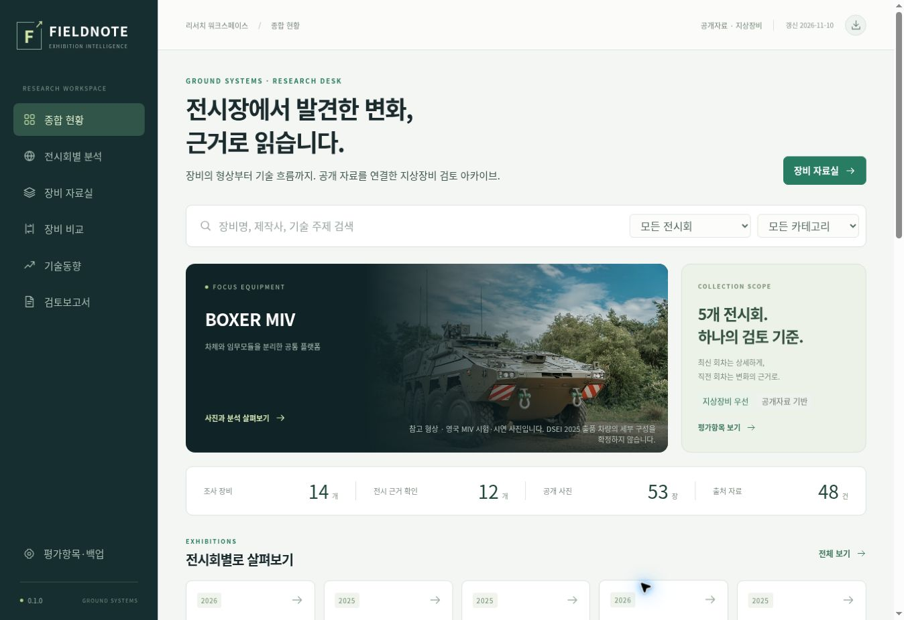

# 전시회 장비 분석 / Exhibition Intelligence

공개 근거를 확인하며 전시 장비 사진·제원·상세 분석·회차별 변화를 검토하는 독립 웹앱.

현재 버전: **0.1.1** · [변경 기록](CHANGELOG.md) · [진행 상태 및 다음 작업](docs/STATUS.md)

**공개 웹앱:** https://qkfhvnfrl-ux.github.io/exhibition-intelligence/



## 포함 기능
- 전시회·장비명·제작사·카테고리 검색, 장비별 사진·제원·분석·변화·출처.
- 사진 방향 필터·확대·2장 비교, 장비 2~4종 비교 및 출처 포함 CSV.
- 보고서 구성 및 인쇄/PDF 저장, 개인 검토 메모, 평가항목 편집, JSON 백업·복원.
- 14개 장비 / 53장 사진 / 71개 제원 / 98개 분석 / 본문 출처 48건.

사진 52장은 기존형·선행형 참고사진입니다. 최신 전시차의 사진과 혼동하지 않도록 형상 차이를 표시했습니다. 장비별 사진 15~30장 목표는 후속 보강 대상입니다.

## 범위
- Eurosatory 2026, DSEI 2025, IDEX 2025, SAHA 2026, 서울 ADEX 2025
- 지상장비 우선. 직전 회차 자료는 변화 검토 근거로 제한.
- 원문 사실, 분석 의견, 확인 필요사항을 분리. 확인되지 않은 전시 참여는 후보로 표시.
- 과거/다른 계열형의 사진은 참고사진으로 명시. 공개 이미지의 재사용 허가와 원출처 보존.

## 실행
Node.js 20 이상. 외부 런타임 패키지 없음.
```sh
npm run build
npm run check
npm run dev
```
로컬 주소는 실행 로그를 따릅니다. `dist/`는 향후 정적 호스팅에 사용할 빌드 결과입니다.

## 배포 상태
GitHub에 소스·공개 데이터·허용된 사진을 버전관리합니다. GitHub Pages는 `main` 변경 시 빌드와 10개 검증을 통과한 `dist/` 산출물을 공개 배포합니다. `release/v0.1.0`은 첫 개발 버전 보관용입니다.

2026-11-10 v0.1.1의 첫 공개 배포와 HTTPS 접속을 확인했습니다. 로그인 없이 열 수 있습니다. 개인 검토 메모는 각 방문자의 브라우저에 저장됩니다.

## 저장 구조
- `data/research/`: 장비별 공개자료와 분석
- `data/photos.json`, `assets/photos/`: 사진 출처·라이선스 및 파일
- `data/exhibitions.json`, `data/criteria.json`: 전시회·평가항목
- `src/`: UI와 동작
- `docs/STATUS.md`: 진행 상태·재개 순서
- `CHANGELOG.md`: 버전 변경 기록

개인 메모와 평가항목 편집은 해당 브라우저에만 저장됩니다. GitHub 원본 데이터는 변경되지 않습니다. JSON 내보내기로 백업하십시오.

## 콘텐츠 해석
제원은 제조사 공개값이며 독립 시험으로 검증한 성능을 의미하지 않습니다. 전시회 출품 상태·목업 여부·차량 계열형은 개별 근거를 확인하십시오. 데이터베이스의 분포는 조사한 표본이며 전시회 전체 통계가 아닙니다.

## 저작물
코드 및 분석문과 제3자 사진의 권리 조건은 구분됩니다. 각 사진의 저작자·라이선스·원문 링크는 사진 명세에 기록합니다. 권리 불명확 사진은 저장하지 않습니다.

사진의 이용조건은 [사진 출처 기록](docs/PHOTO_SOURCES.md)과 `data/photos.json`을 따릅니다. 이미지 변환본도 원본의 저작자 표시·동일조건변경허락 등 개별 조건을 유지합니다.
